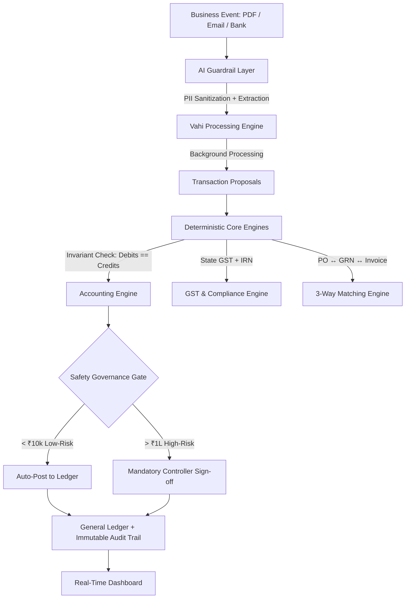

<div align="center">
  <h1>Vahi (वही) ⚡</h1>
  <p><strong>Familiar Accounting, Redesigned for the AI Era</strong></p>
  
  [](https://opensource.org/licenses/Apache-2.0)
  [](https://www.typescriptlang.org/)
  [](https://nextjs.org/)
  [](https://prisma.io/)
</div>

> *"The user experiences automation, not agents. Business software that happens to be intelligent."*

**Vahi** (Sanskrit "वही" = business ledger/book) is a production-ready, AI-native business operating system and accounting platform designed to completely replace legacy tools like Tally Prime. It combines strict **double-entry accounting precision**, complete **Indian statutory compliance** (GST, E-Invoicing, E-Way Bills), and **proactive background automation** in a clean SaaS workspace.

For a complete operational manual and feature walkthrough, please read the [User Guide](./USER_GUIDE.md).

---

## 📑 Table of Contents
- [Architecture](#-architecture)
- [Tech Stack](#-tech-stack)
- [Project Structure](#-project-structure)
- [Getting Started](#-getting-started)
- [Database Management](#-database-management)
- [Testing](#-testing)
- [Security & Governance](#-security--governance)
- [Contributing](#-contributing)

---

## 🏛️ Architecture

Vahi relies on deterministic core engines augmented by an AI guardrail layer. It prevents data contamination by employing a strict separation between semantic inputs and deterministic accounting constraints.



---

## 🏗️ Tech Stack

Vahi is built as a modern monorepo using state-of-the-art tooling:

- **Framework:** [Next.js](https://nextjs.org/) (App Router)
- **Language:** [TypeScript](https://www.typescriptlang.org/) (Strict mode)
- **Database:** [PostgreSQL](https://www.postgresql.org/) / SQLite (Local) with [Prisma ORM](https://www.prisma.io/)
- **Styling:** [Tailwind CSS](https://tailwindcss.com/)
- **Monorepo Management:** npm Workspaces (Scalable for `apps/*` and `packages/*`)
- **State Management:** React Server Components + Hooks
- **AI Integration:** Specialized Local/Cloud LLM bindings with strict Zod parsing

---

## 📁 Project Structure

```text
tallyAINative/
├── apps/
│   └── web/                 # Main Next.js Web Application
│       ├── src/
│       │   ├── components/  # React components (auth, layout, workspaces)
│       │   ├── lib/         # Core business logic (engine/, actions/)
│       │   └── app/         # Next.js App Router pages
│       └── prisma/          # Database schemas and migrations
├── packages/                # Shared internal libraries (e.g. ui, config)
├── package.json             # Root workspace configuration
└── USER_GUIDE.md            # End-user documentation
```

---

## 🚀 Getting Started

### Prerequisites

- [Node.js](https://nodejs.org/en/) (v18.17 or higher)
- npm (v9 or higher)

### Installation

1. **Clone the repository:**
   ```bash
   git clone <repository-url>
   cd tallyAINative
   ```

2. **Install dependencies:**
   ```bash
   npm install
   ```

3. **Configure Environment Variables:**
   Copy `.env.example` to `.env` in `apps/web/` and update your variables:
   ```bash
   cp apps/web/.env.example apps/web/.env
   ```

### Local Development

Start the development server across the monorepo:

```bash
npm run dev
```

The application will be available at [http://localhost:3000](http://localhost:3000).

---

## 🗄️ Database Management

Vahi uses Prisma as its ORM. The schema is located in `apps/web/prisma/schema.prisma`.

**Common Commands:**
```bash
# Push schema changes to your development database
npm --prefix apps/web run prisma db push

# Generate Prisma Client after schema changes
npm --prefix apps/web run prisma generate

# Open Prisma Studio to view/edit data
npm --prefix apps/web run prisma studio
```

---

## 🧪 Testing

We adhere to a robust testing strategy covering deterministic logic and UI components.

```bash
# Run unit and integration tests
npm run test

# Run linting
npm run lint
```

*Note: Ensure core accounting logic (like GST engine and 3-way matching) has high coverage.*

---

## 🔒 Security & Governance

Vahi employs a 6-Level Enterprise Safety Governance Framework to prevent unauthorized ledger mutations.

| Level | Classification | Policy Enforcement |
|---|---|---|
| **L0** | Read-Only | Fully Autonomous |
| **L1** | Draft Generation | Soft User Confirmation |
| **L2** | Tax & Invariant Check | Deterministic Validation (e.g., Debit = Credit) |
| **L3** | Standard Reconcile | Auto-Posted with Log (< ₹50k) |
| **L4** | High-Value Action | **Mandatory Human Approval** (> ₹1,00,000) |
| **L5** | Ledger Mutation | Immutable Audit Log Required (Reversals) |

---

## 🤝 Contributing

1. **Fork the repository** and create your feature branch: `git checkout -b feature/my-new-feature`
2. **Commit your changes** adhering to [Conventional Commits](https://www.conventionalcommits.org/): `git commit -am 'feat: add some feature'`
3. **Push to the branch**: `git push origin feature/my-new-feature`
4. **Submit a Pull Request** detailing the architectural impact and test coverage.

Please ensure all PRs pass CI checks (`npm run lint` and `npm run test`) before requesting a review.

---

## 📄 License

This project is licensed under the Apache 2.0 License - see the [LICENSE](LICENSE) file for details.
