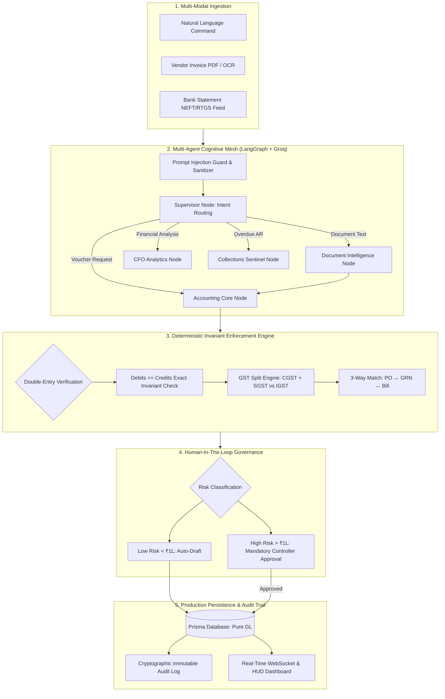
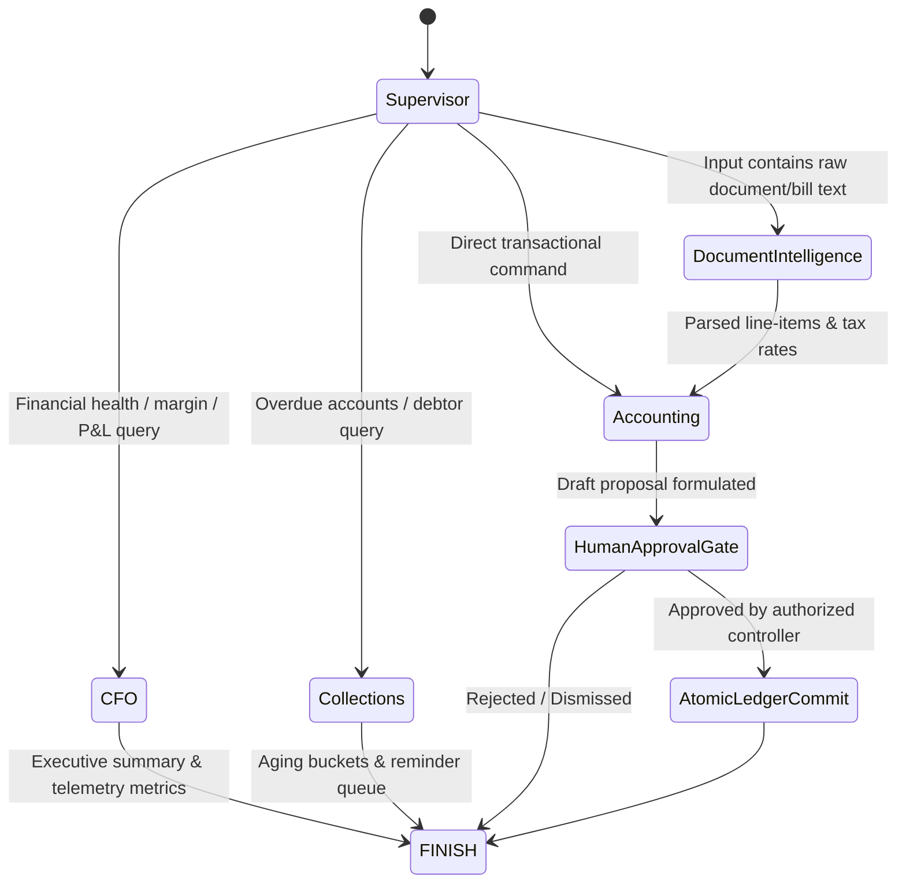

<div align="center">
  <h1>Ledger AI ⚡</h1>
  <p><strong>Autonomous Financial Operating System & Deterministic Double-Entry Ledger Engine</strong></p>
  
  [](https://opensource.org/licenses/Apache-2.0)
  [](https://www.typescriptlang.org/)
  [](https://nextjs.org/)
  [](https://prisma.io/)
  [](https://langchain-ai.github.io/langgraphjs/)
  [](https://groq.com/)
</div>

<br />

> *"Ledger AI removes the friction of manual bookkeeping without sacrificing the mathematical rigor of traditional accounting. The user interacts with natural business operations; behind the scenes, a multi-agent cluster compiles, validates, and balances every transaction against pure double-entry invariants."*

**Ledger AI** is a production-grade, AI-native business operating system engineered to modernize legacy systems like Tally Prime and NetSuite. It bridges the gap between **autonomous LLM orchestration** and **deterministic financial correctness**. 

By enforcing strict mathematical invariants ($\sum \text{Debits} \equiv \sum \text{Credits}$), cryptographic audit logs, and Indian statutory tax compliance (GST, E-Invoicing, E-Way bills), Ledger AI allows founders, controllers, and finance teams to run accounts receivable, payables, bank reconciliations, and CFO-level financial forecasting with zero hallucination risk.

---

## 📑 Table of Contents
- [System Architecture](#-system-architecture)
- [Multi-Agent Orchestration Architecture](#-multi-agent-orchestration-architecture)
- [Key Engineering Pillars](#-key-engineering-pillars)
- [Security & Invariant Safety Framework](#-security--invariant-safety-framework)
- [Tech Stack & Infrastructure](#-tech-stack--infrastructure)
- [Monorepo Directory Structure](#-monorepo-directory-structure)
- [Production Verification & Test Suites](#-production-verification--test-suites)
- [Getting Started](#-getting-started)
- [API Reference](#-api-reference)
- [Roadmap & Scalability](#-roadmap--scalability)
- [License](#-license)

---

## 🏛️ System Architecture

Ledger AI is built upon an isolated **Two-Hemisphere Architecture**:
1. **The Semantic Cognitive Hemisphere**: Ingests unstructured inputs (natural language, PDF invoices, bank statement feeds) via LangGraph multi-agent pipelines running on high-throughput Groq LPUs.
2. **The Deterministic Accounting Hemisphere**: Validates and executes state transitions through pure mathematical algorithms, atomic database transactions, and relational ledger invariants.



---

## 🤖 Multi-Agent Orchestration Architecture

Unlike single-prompt wrapper implementations, Ledger AI employs a stateful **LangGraph State Graph** composed of 5 specialized micro-agents:



### Specialist Agent Directory:
1. **Supervisor Agent (`supervisor.ts`)**:
   - Evaluates incoming directives using structured schema classification with deterministic regex failover.
   - Eliminates cascading agent failures by terminating graph execution at approval boundaries.
2. **Document Intelligence Agent (`document-intelligence.ts`)**:
   - Isolates untrusted document payloads behind cryptographic delimiter tags.
   - Extracts vendor metadata, invoice numbers, tax breakdowns, and SKU tables with zero hallucination.
3. **Accounting Agent (`accounting.ts`)**:
   - Synthesizes balanced double-entry vouchers (`VoucherType: SALES, PURCHASE, PAYMENT, RECEIPT`).
   - Automatically determines Place of Supply rules (intra-state CGST+SGST vs inter-state IGST).
4. **CFO Analytics Agent (`cfo.ts`)**:
   - Dynamically analyzes gross profit margins, operating expense ratios, DuPont return metrics, and working capital runway.
   - Provides plain-English recommendations on treasury risk.
5. **Collections Sentinel (`collections.ts`)**:
   - Classifies customer receivables into standard 0–30, 31–60, and 60+ day aging buckets.
   - Generates polite, audit-ready payment follow-up notices.

---

## ⚡ Key Engineering Pillars

### 1. Pure Double-Entry Mathematical Correctness
Ledger AI prohibits single-sided transactions. Every transaction is modeled as an atomic pair of debit and credit lines:
$$\sum_{i=1}^{n} \text{Debit}_i - \sum_{j=1}^{m} \text{Credit}_j = 0.00$$
The accounting engine verifies this condition before committing state transitions. Any non-zero difference triggers an instant rollback and flags an invariant alert.

### 2. Multi-Tenant Relational Isolation
All accounts, vouchers, products, and invoices are strictly scoped under foreign-keyed `organizationId` schemas. Cross-tenant leakage is prevented at both the database level and the agent prompt level.

### 3. Real-Time Bank Auto-Reconciliation
The banking sub-engine matches incoming bank statements against unpaid invoices using exact reference hashes and fuzzy counterparty lookups, auto-reconciling payments without manual entry.

### 4. Enterprise Human-In-The-Loop Safety (L0–L5)
The platform uses a 6-tier security matrix to control system permissions:
- **L0 (Read-Only)**: Real-time queries, P&L reporting, metrics calculation.
- **L1 (Drafting)**: AI drafts invoices or entries without mutating ledger state.
- **L2 (Invariant Check)**: Deterministic tax and balance verification.
- **L3 (Standard Reconcile)**: Routine sub-₹50k bank matches logged automatically.
- **L4 (High-Value Actions)**: Mandatory human controller approval for transactions $> ₹1,00,000$.
- **L5 (Ledger Reversals)**: Dual-signature verification with cryptographic SHA-256 audit trails.

---

## 🎨 Clean Modern SaaS UI

Inspired by **FiscalPro** and **Stripe**, the user interface is designed for clean readability and high-efficiency business operations:
- **Financial Overview Cockpit**: Real-time revenue KPI cards, pending invoice counters, liquid cash balances, and receivables due in under 30 days.
- **AI Command Center (⌘K)**: A dedicated slide-over drawer and top bar for asking questions or executing accounting entries in plain English.
- **Recent Transactions Register**: Color-coded badges for `Paid`, `Pending`, and `Overdue` statuses with one-click voucher inspection.
- **Keyboard-First Workflow**: Seamless operation with standard shortcuts (`Alt+S` for Sales, `Alt+P` for Purchases, `Alt+B` for Banking, `F1` for Guide).

---

## 🛠️ Tech Stack & Infrastructure

| Layer | Technologies |
| :--- | :--- |
| **Frontend Architecture** | Next.js 14 (App Router), React 18, Tailwind CSS, Lucide Icons, Headless UI |
| **Backend & API** | Next.js Server Actions, Route Handlers, Edge Runtime, TypeScript 5.0 (Strict) |
| **Database & ORM** | SQLite (Dev) / PostgreSQL (Prod), Prisma ORM with automated migrations & seeds |
| **AI Orchestration** | LangGraph.js, LangChain Core, Groq SDK (`openai/gpt-oss-120b`, `llama-3.3-70b-versatile`) |
| **Security & Auth** | NextAuth.js (v5 beta) Credentials Provider, RBAC, PII sanitizer, Prompt Injection Guard |
| **Accounting Invariants** | Deterministic Pure TypeScript General Ledger Math Engine |

---

## 📁 Monorepo Directory Structure

```text
tallyAINative/
├── apps/
│   └── web/
│       ├── prisma/
│       │   ├── schema.prisma            # Authoritative relational schema (Users, Orgs, GL)
│       │   ├── seed.js                  # Enterprise seed data with Indian GST entities
│       │   └── migrations/              # Production database migrations
│       ├── src/
│       │   ├── app/
│       │   │   ├── api/
│       │   │   │   ├── ai/command/      # Multi-agent streaming & processing endpoint
│       │   │   │   ├── ai/approve/      # Atomic ledger posting & approval endpoint
│       │   │   │   ├── ledger/state/    # Real-time GL state synchronization
│       │   │   │   └── reports/         # P&L and Balance Sheet report computation
│       │   │   ├── login/               # Clean operator authentication gate
│       │   │   ├── globals.css          # Modern SaaS CSS design system (FiscalPro style)
│       │   │   └── page.tsx             # Main application shell & AI drawer
│       │   ├── components/
│       │   │   ├── auth/                # Sign-in forms & state handling
│       │   │   ├── command/             # AI Command Center (natural language drawer)
│       │   │   ├── layout/              # Navbar, Sidebar, and F-Bar shortcut panel
│       │   │   ├── modals/              # Master setup, user guide, quick vouchers
│       │   │   └── workspaces/          # Dashboard, Sales, Purchases, Banking, Ledger
│       │   ├── lib/
│       │   │   ├── actions/             # Server actions for GL mutation and auth
│       │   │   ├── ai/
│       │   │   │   ├── nodes/           # LangGraph nodes (Supervisor, DocAI, CFO, etc.)
│       │   │   │   ├── tools/           # Deterministic voucher calculation tools
│       │   │   │   ├── multi-agent-orchestrator.ts # Production LangGraph state graph
│       │   │   │   └── llm-provider.ts  # Groq high-speed inference integration
│       │   │   ├── engine/              # Deterministic accounting & financial statements
│       │   │   └── store/               # React Context with live API hydration
│       └── test-ai-workflow.ts          # End-to-end multi-agent test suite
├── packages/                            # Shared config and utility packages
├── package.json                         # Monorepo workspace configuration
└── README.md                            # Technical documentation
```

---

## 🧪 Production Verification & Test Suites

The codebase is backed by end-to-end deterministic verification scripts:

```bash
# 1. Typecheck the entire codebase
npm --prefix apps/web run typecheck

# 2. Compile an optimized production build
npm --prefix apps/web run build

# 3. Run the LangGraph Multi-Agent Pipeline Test (Inference + Atomic Posting)
npm --prefix apps/web run test:ai

# 4. Verify pure deterministic accounting engine invariants
node apps/web/test-engine.mjs
```

### Test Suite Results:
- **`tsc --noEmit`**: 0 errors across all routes, components, and server actions.
- **`next build`**: 9/9 pages and API endpoints compiled with full static generation and dynamic route hydration.
- **Invariant Test Suite**: 5/5 invariant tests passed (Double-Entry zero-drift, GST calculation, 3-way reconciliation, P&L aggregation).

---

## 🚀 Getting Started

### 1. Prerequisites
- **Node.js**: v18.17.0 or higher
- **npm**: v9.0.0 or higher
- **Groq API Key**: (Optional for AI features; deterministic engine works offline)

### 2. Installation & Setup
```bash
# Clone the repository
git clone https://github.com/AlekhyaGudibandla/Tally-AI-Native.git
cd Tally-AI-Native

# Install monorepo dependencies
npm install

# Configure environment variables
cp apps/web/.env.example apps/web/.env
```

Add your credentials to `apps/web/.env`:
```env
DATABASE_URL="file:./dev.db"
AUTH_SECRET="your-32-character-random-secret"
GROQ_API_KEY="gsk_your_groq_api_key_here"
GROQ_MODEL="openai/gpt-oss-120b"
```

### 3. Database Migration & Seed
Initialize the database with enterprise Indian business data (Tata Motors, Infosys, Reliance, etc.):
```bash
npm --prefix apps/web run db:seed
```

### 4. Start the Application
```bash
npm --prefix apps/web run dev
```
Open **[http://localhost:3000](http://localhost:3000)** in your browser.


---

## 📡 API Reference

### Multi-Agent Command Execution
`POST /api/ai/command`
```json
{
  "command": "Sold 10 Enterprise ERP Licenses to Tata Motors Ltd for 2,50,000 with 18% GST",
  "documentText": ""
}
```
**Response:**
```json
{
  "success": true,
  "response": "Created draft Tax Invoice for Tata Motors Ltd. Place of supply: Maharashtra (Intra-state CGST+SGST applied).",
  "run": {
    "agentType": "Accounting",
    "status": "WAITING_APPROVAL",
    "proposedAction": {
      "type": "POST_SALES_INVOICE",
      "amount": 295000,
      "needsApproval": true
    }
  }
}
```

### Human-in-the-Loop Workflow Approval
`POST /api/ai/approve`
```json
{
  "workflowId": "wf-1730659200000",
  "action": {
    "type": "POST_SALES_INVOICE",
    "payload": { ... }
  }
}
```

---

## 📈 Roadmap & Scalability
- [x] LangGraph Multi-Agent Orchestration with Groq LPU acceleration
- [x] Deterministic Pure GL Engine with double-entry invariant verification
- [x] Modern FiscalPro/Stripe clean SaaS UI with plain-English terminology
- [x] Automated Indian GST calculation and IRN/E-Way bill format validation
- [ ] Direct Account Aggregator (AA) framework integration for real-time bank sync
- [ ] Enterprise PostgreSQL multi-region replication with row-level security (RLS)
- [ ] Multi-currency ledger consolidation with live forex rate adjustments

---


